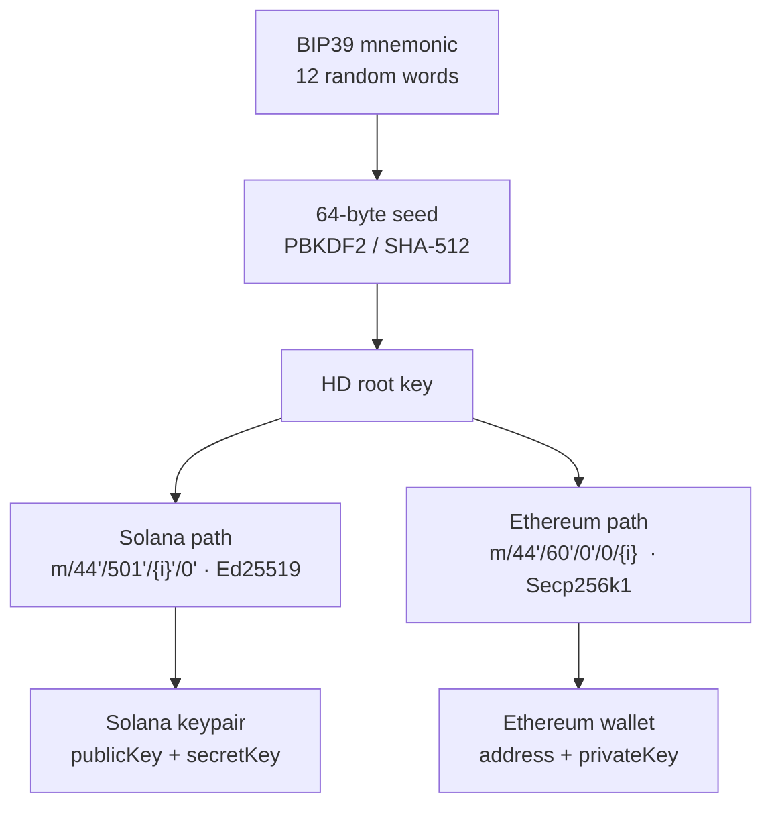
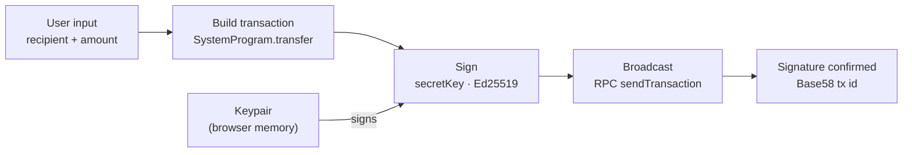

# Aarav Wallet

A non-custodial, multi-chain web wallet for Solana and Ethereum. Built with React, TypeScript, and Tailwind CSS.

---

## Overview

Aarav Wallet derives Solana and Ethereum accounts from a single BIP39 mnemonic. Private keys never leave the browser — there is no backend, no account system, and no telemetry.

---

## Features

- Multi-chain account management from a single seed phrase (Solana + Ethereum)
- BIP39 mnemonic generation with HD wallet derivation (BIP44)
- Live SOL and USDC balance fetching via Solana RPC
- SOL transfers with real-time transaction signature confirmation
- Session-only key storage — all data is wiped on refresh or erase

---

## How It Works

### Key derivation

A single mnemonic generates all accounts deterministically. Incrementing the index derives a new account without changing the phrase.



### Transaction flow (SOL)

The keypair never leaves memory. Signing happens locally before the transaction is broadcast.



---

## Project Structure

```
src/
├── app/
│   ├── wallet.ts       # Mnemonic generation, HD derivation
│   └── solana.ts       # RPC calls, balance fetching, transfers
└── components/
    ├── WalletCard.tsx
    ├── MnemonicSection.tsx
    └── SendModal.tsx
```

---

## API Reference

### `wallet.ts`

#### `generateMnemonic(): string`
Returns a cryptographically random 12-word BIP39 mnemonic.

#### `deriveSolanaWallet(mnemonic, index): SolanaWallet`
Derives a Solana keypair at the given index.

```ts
{ publicKey: string, secretKey: string, keypair: Keypair, index: number }
```

#### `deriveEthereumWallet(mnemonic, index): EthereumWallet`
Derives an Ethereum account at the given index.

```ts
{ address: string, privateKey: string, index: number }
```

---

### `solana.ts`

#### `getSolBalance(address): Promise<number>`
Returns the SOL balance for a Base58 public key.

#### `getUSDCBalance(address): Promise<number>`
Returns the USDC token balance for a given owner address.

#### `sendSol(fromKeypair, toAddress, amount): Promise<string>`
Signs and broadcasts a SOL transfer. Returns the transaction signature.

---

## Setup

```bash
npm install
npm run dev
```

To use a custom RPC endpoint, create a `.env` file:

```env
SOLANA_RPC_ENDPOINT=https://api.mainnet-beta.solana.com
```

---

## Security

This is a client-side only application. The mnemonic and all derived keys exist solely in browser memory for the duration of the session. Nothing is persisted to localStorage, sent to a server, or logged anywhere. Clicking **Erase** or refreshing the page destroys all session data.

Back up your recovery phrase offline before closing the tab.