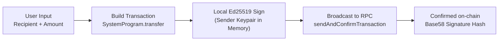

# Aarav Wallet

A modern, non-custodial multi-chain web wallet supporting **Solana** and **Ethereum**. Built with **React 19**, **TypeScript**, **Tailwind CSS v4**, and **Vite**.

Private keys and seed phrases exist exclusively in volatile browser memory — no remote servers, no telemetry, no tracking, and zero database persistence.

---

## Features

- **Multi-Chain Derivation**: Deterministically derive multiple Solana and Ethereum accounts from a single 12-word BIP39 mnemonic.
- **Aggregated Portfolio Overview**: Live portfolio bar calculating total combined balances across all derived accounts (SOL, ETH, USDC).
- **Network Filtering**: Segmented account switcher (`All`, `Solana`, `Ethereum`) with live account counters for fast navigation.
- **Send & Transfer (SOL)**: Construct, sign, and broadcast native Solana transactions directly on-chain with instant signature confirmation and fee estimation.
- **Receive & QR Code**: Live QR code generator and one-click address copy for receiving SOL, SPL tokens, ETH, and ERC-20 assets.
- **Private Key Export**: Securely export and inspect raw private keys (Base58 for Solana, Hex for Ethereum) protected by click-to-reveal obfuscation.
- **Explorer Integration**: Direct deep-links to [Solscan](https://solscan.io) and [Etherscan](https://etherscan.io) for any derived account.
- **Non-Custodial & Ephemeral**: Keys remain in memory only. Closing the browser tab or clicking **Lock / Erase** permanently purges all session state.

---

## Architecture & Cryptography

All accounts originate deterministically from a single master seed using standard BIP44 derivation paths:

```mermaid
flowchart TD
    A["BIP39 Mnemonic\n(12-word Recovery Phrase)"] --> B["64-Byte Binary Seed\n(PBKDF2 / HMAC-SHA512)"]
    B --> C["HD Root Key"]
    C -->|m/44'/501'/{i}'/0'| D["Solana Derivation\n(Ed25519 Curve)"]
    C -->|m/44'/60'/0'/0/{i}| E["Ethereum Derivation\n(Secp256k1 Curve)"]
    D --> F["Solana Account #{i}\nBase58 Public Key & Keypair"]
    E --> G["Ethereum Account #{i}\nEIP-55 Hex Address & Private Key"]
```

### Transaction Signing Flow (Solana)

Transactions are constructed and signed entirely client-side before being broadcast to the RPC node:



---

## Project Structure

```
src/
├── app/
│   ├── wallet.ts             # BIP39 generation & HD path derivation (Ed25519 & Secp256k1)
│   └── solana.ts             # Solana web3 connection, balance queries, and transfer logic
├── components/
│   ├── WalletCard.tsx        # Compact account card with balance, copy pill, and actions
│   ├── MnemonicSection.tsx   # Recovery phrase grid with secure click-to-reveal toggle
│   ├── SendModal.tsx         # SOL transfer modal with fee estimation and status handling
│   ├── ReceiveModal.tsx      # QR code generator and full address display
│   ├── PrivateKeyModal.tsx   # Secure private/secret key export modal
│   ├── Toast.tsx             # Context-based notification toast system
│   └── Dialog.tsx            # Confirmation modal for account removal and wallet erase
├── App.tsx                   # Main state orchestration, filtering, and portfolio summary
├── main.tsx                  # Polyfills (Buffer/Process) and React 19 root mount
└── index.css                 # Tailwind v4 configuration, font styling, and custom animations
```

---

## Tech Stack

| Layer | Technology |
|---|---|
| **Framework** | [React 19](https://react.dev/) + [Vite](https://vitejs.dev/) |
| **Language** | [TypeScript 5.9](https://www.typescriptlang.org/) |
| **Styling** | [Tailwind CSS v4](https://tailwindcss.com/) (`@tailwindcss/vite`) |
| **Solana Engine** | [`@solana/web3.js`](https://solana.com/docs) & [`@solana/spl-token`](https://spl.solana.com/token) |
| **Ethereum Engine** | [`ethers v6`](https://docs.ethers.org/v6/) |
| **Derivation & Crypto** | `bip39`, `ed25519-hd-key`, `tweetnacl`, `bs58` |

---

## Getting Started

### Prerequisites

- [Node.js](https://nodejs.org/) (version 18.0 or higher recommended)
- `npm`, `pnpm`, or `yarn`

### Installation

1. **Clone the repository:**
   ```bash
   git clone https://github.com/your-username/webbasedwallet.git
   cd webbasedwallet
   ```

2. **Install dependencies:**
   ```bash
   npm install
   ```

3. **Configure environment variables (optional):**
   Create a `.env` file in the root directory:
   ```env
   # Defaults to Solana Mainnet-Beta if omitted
   SOLANA_RPC_ENDPOINT=https://api.mainnet-beta.solana.com
   ```
   *(For testing, you can use Solana Devnet or private RPC providers like Helius, QuickNode, or Alchemy).*

4. **Run development server:**
   ```bash
   npm run dev
   ```

5. **Build for production:**
   ```bash
   npm run build
   npm run preview
   ```

---

## Security Model

- **No Remote Transmission**: Your mnemonic seed phrase and private keys are generated via cryptographic PRNG locally and never transmitted across the network.
- **In-Memory Volatility**: Credentials are held in JavaScript runtime state only. They are not persisted to `localStorage`, `sessionStorage`, or cookies.
- **Zero Telemetry**: No analytics scripts, tracker cookies, or remote logging.
- **Disposable Sessions**: Clicking **Lock / Erase** or refreshing the page purges the in-memory keys immediately.

> [!CAUTION]
> Always write down and safely store your 12-word recovery phrase offline. Because this wallet is strictly non-custodial and serverless, forgotten recovery phrases cannot be recovered by anyone.

---

## License

This project is licensed under the [MIT License](LICENSE).
